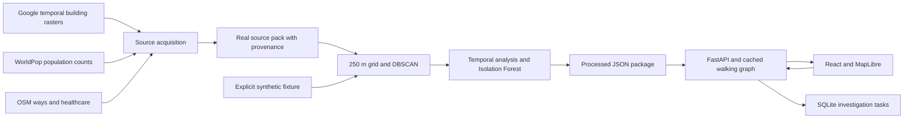

# Architecture

The Missing Millions is a local investigation tool. Its unit of analysis is an aggregated settlement candidate, not a household. Buildings, population models, mapped facilities, calculated routes and hypothetical outreach points retain their separate meanings throughout the application.

The offline preparation pipeline lives in `pipeline/`. `ingest/acquire_sources.py` downloads only an explicitly requested real source pack. It uses the anonymous Cloud Storage route linked by Google Research, so Earth Engine credentials are unnecessary for this route. It reads native raster windows rather than downloading complete country rasters. `ingest/rasters.py` supplies local raster aggregation helpers. `geospatial/grid.py` handles projected cells, clustering, count aggregation and non-overlapping assignment. `ml/analysis.py` implements temporal analysis, anomaly ranking and transparent priority scores.

`pipeline/build_demo.py` writes separate `data/processed/demo.json` and `data/processed/real.json` packages. Synthetic input generation is explicit. A failed real acquisition does not create or replace a real package with synthetic measurements. The real 5 km source sample and larger illustrative fixture answer different demonstration needs; only the real package supports statements about acquired geographic evidence.

The FastAPI server in `services/api/` reads the package configured by `DATA_PACKAGE_PATH`, constructs its walking graph and caches the loaded result until the file changes. Small anomaly models are recomputed once on package load after routing enrichment. Subsequent requests reuse these results. Raster acquisition and raster processing never run in request handlers. Multi-source shortest paths calculate access to mapped facilities. The outreach simulator reuses graph distances to compare hypothetical locations.

The React, TypeScript and MapLibre client in `apps/web/` consumes the same GeoJSON and evidence returned by the API. Its local map layers work without a paid basemap. No remote imagery is required for the reveal. The building signal layer is an analysis-cell visualization; cell polygons are never represented as building outlines. The evidence panel, timeline, provenance inspector and methodology panel expose the underlying values and assumptions.

SQLite stores investigation notes, status, evidence snapshots and geometry locally. Creating a task does not contact local partners, change OSM or establish that an intervention is approved. The task list supports JSON and CSV export.

## API surface

| Endpoint | Purpose |
| --- | --- |
| `GET /api/health` | Application and loaded-package status |
| `GET /api/regions` | Region and mode metadata |
| `GET /api/regions/{id}/overview` | Aggregate evidence and source limitations |
| `GET /api/regions/{id}/layers` | Candidate, cell, facility, road and route GeoJSON |
| `GET /api/regions/{id}/settlements` | Candidate ranking and evidence |
| `GET /api/settlements/{id}` | Full candidate record |
| `GET /api/regions/{id}/timeline` | Available source years |
| `GET /api/regions/{id}/manifest` | Downloadable provenance |
| `POST /api/outreach/simulate` | Hypothetical network coverage scenario |
| `POST/GET /api/verification-tasks` | Persist or list investigations |
| `PATCH /api/verification-tasks/{id}` | Change notes/status |
| `GET /api/verification-tasks/export` | JSON or CSV export |

External coordinates are WGS84 longitude/latitude. Metric calculations use local UTM metres. Unknown quantities are JSON `null`, and invalid requests return structured errors.

## Practical limits

By default, the API discovers the prepared real and synthetic packages and keeps their graph engines separate. Setting `DATA_PACKAGE_PATH` explicitly starts a single-package session; restart after changing that setting. This proof of concept has no multi-user authorization, authoritative facility registry, terrain model, imagery viewer or production deployment. It deliberately avoids an LLM dependency: explanations are derived deterministically from computed evidence. Local organizations and communities must evaluate any apparent gap and participate in planning.
